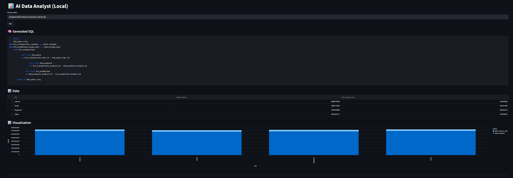
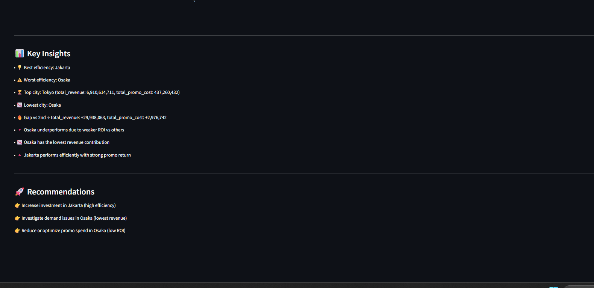

# InsightCopilot

An applied-insight analytics assistant for a retail dataset: ask a business question in plain English, get back the SQL that answers it, the data, an AI-generated narrative insight, flagged anomalies, a root-cause breakdown, and ranked recommendations.

Built with FastAPI, Streamlit, PostgreSQL, dbt, and a local LLM (DeepSeek via Ollama).




---

## What this actually is (read this before the feature list)

This is **not** a generic "connect to any database" NL2SQL tool -- that's an open problem the industry hasn't solved either (state-of-the-art models still collapse from ~85% accuracy on clean academic benchmarks to 10-20% on real enterprise schemas). This project is deliberately scoped to one retail schema, and it uses a **hybrid approach**: an LLM proposes SQL and identifies relevant tables, but the actual query that runs is assembled through a constrained, whitelist-based builder -- never executed directly from raw LLM output. That's a safety-by-construction choice, not a limitation to apologize for.

## Architecture

```
User question (natural language)
        |
        v
[ LLM: table/intent extraction ]  <-- llm/deepseek_sql.py
        |
        v
[ Whitelist SQL validator ]        <-- core/sql_validator.py
        |  (unknown table / unsafe SQL -> fallback query)
        v
[ Query builder + join engine ]    <-- core/pipeline.py, core/join_engine.py
        |
        v
[ PostgreSQL ]  <-- dbt-modeled star schema (retail_dbt/)
        |
        v
   +----+----------------+------------------+
   |                     |                  |
[Anomaly detection] [Root cause]     [Recommender]
core/anomaly.py     core/root_cause.py core/recommender.py
   |                     |                  |
   +----------+----------+------------------+
              v
     [LLM insight generation + grounding check]
              core/insight.py
              |
              v
      FastAPI (api/main.py) -> Streamlit UI (streamlit_app.py)
```

### Schema

The app queries a dbt-modeled star schema (see `retail_dbt/models/`):

- `fct_transactions` -- transaction fact table (the hub; joins to everything else)
- `dim_users` -- user dimension (city, etc.)
- `dim_products` -- product dimension (name, category)
- `fct_promotions` -- promotion cost, joined via `dim_products`

`db/postgres.ALLOWED_TABLES` and `core/join_engine.JOIN_MAP` are the single source of truth for what the LLM is allowed to see and join -- they're kept deliberately in sync with this schema rather than with a separate app-only schema, which was a real bug caught and fixed during development (see Known Limitations).

## Features

- **Natural language -> SQL**, constrained by a whitelist validator (rejects unknown tables/columns and unrecognized join pairs; forbids DELETE/UPDATE/INSERT/DROP/etc.)
- **Anomaly detection** using Median Absolute Deviation by default (more robust to extreme outliers than plain z-score, which is also available), with a severity rating per anomaly
- **Root cause analysis** that compares an anomalous day against a rolling baseline per dimension (e.g. product, city), ranks contributors by delta vs. baseline, and flags whether a spike is spread across many transactions or concentrated in a few
- **Recommendation engine** using a percentile-rank composite score (volume, consistency, frequency) instead of arbitrary fixed weights on raw values
- **LLM-generated narrative insight** with a lightweight grounding check: numbers the model mentions are cross-checked against the actual data (raw values + sums/means/counts) and flagged if they don't match, instead of trusting the narrative blindly
- **Automatic chart generation** for query results

## Design decisions (the "why", for anyone reviewing this)

- **Why hybrid rule+LLM SQL generation instead of pure text-to-SQL?** Pure LLM-generated SQL executed directly against a real database is a real safety and reliability risk -- enterprise text-to-SQL tools hit this same wall. The LLM here is used for intent/table extraction; the actual query is always assembled through vetted templates.
- **Why MAD over z-score for anomaly detection?** Z-score uses mean/std, which a single extreme spike can distort, potentially masking other real anomalies. MAD uses the median and is far less sensitive to that.
- **Why percentile-rank scoring in the recommender instead of fixed weights?** `total_sales`, `avg_sales`, and `frequency` are on different scales; a fixed weight on raw values just lets whichever metric has the biggest numbers dominate. Ranking to a 0-1 percentile first makes the weights mean what they say.
- **Why a grounding check on LLM insights instead of trusting the output?** LLMs narrating over data can invent plausible-sounding numbers. The check isn't formal verification -- it's a cheap heuristic that catches the common case of a fabricated figure.

## Known limitations

Being upfront about these rather than hiding them:

- The NL->SQL layer is keyword/pattern-based underneath the LLM extraction step (e.g. "by city", "by product") -- questions phrased very differently from these patterns fall back to a static query rather than being understood.
- The grounding check on LLM insights is a heuristic (regex number extraction vs. dataframe values), not a formal correctness guarantee.
- Anomaly detection and root-cause analysis assume a specific column shape (`date`, `sales`, a dimension column) after an explicit rename step in the API layer -- queries that don't produce those columns skip these steps rather than erroring.
- This is scoped to one schema by design (see "What this actually is" above), not a general-purpose tool for arbitrary databases.

## Setup

### 1. Database

```bash
cd retail_dbt
dbt run
dbt test
cd ..
```

### 2. Environment

```bash
cp .env.example .env
# edit .env with your real DB_PASSWORD etc.
```

### 3. Install dependencies

```bash
pip install -r requirements.txt
```

### 4. Run tests

```bash
python -m pytest tests/ -q
```

### 5. Run the app

```bash
# terminal 1
python -m uvicorn api.main:app --reload

# terminal 2
streamlit run streamlit_app.py
```

## Example questions

- "Show total sales by city"
- "What is the total revenue by product?"
- "What is the total promo cost by product?"

## Tech stack

Python, FastAPI, Streamlit, PostgreSQL, dbt, Pandas, DeepSeek (via Ollama), pytest, scikit-learn, statsmodels.

## Roadmap

- [ ] Feedback loop: log question/SQL/insight + thumbs up/down, track insight accuracy over time
- [ ] Expand NL->SQL pattern coverage beyond the current keyword set
- [ ] Auto-generate `JOIN_MAP` from database foreign keys instead of a manual dict
